<!--
  README generado automáticamente por scripts/src/readme.ts.
  No editar a mano: cambia scripts/src/config/profile.ts y ejecuta `npm run build`.
-->

<a href="https://omarhernandezrey.com"><picture><source media="(prefers-color-scheme: dark)" srcset="./assets/generated/header-dark.svg"></picture></a>

<a href="https://omarhernandezrey.com"><picture><source media="(prefers-color-scheme: dark)" srcset="./assets/generated/button-1-dark.svg">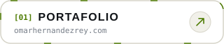</picture></a> <a href="https://www.linkedin.com/in/omarhernandezrey"><picture><source media="(prefers-color-scheme: dark)" srcset="./assets/generated/button-2-dark.svg"></picture></a> <a href="mailto:omarhernandezrey@gmail.com"><picture><source media="(prefers-color-scheme: dark)" srcset="./assets/generated/button-3-dark.svg">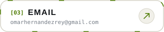</picture></a>

 

<picture><source media="(prefers-color-scheme: dark)" srcset="./assets/generated/divider-perfil-dark.svg">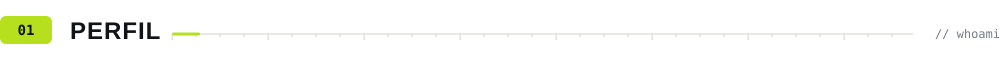</picture>

<picture><source media="(prefers-color-scheme: dark)" srcset="./assets/generated/dossier-dark.svg"></picture>

Construyo aplicaciones web **rápidas, seguras y listas para producción** con React, Next.js, TypeScript y Node.js: desde la interfaz responsive y las APIs REST hasta PostgreSQL, MongoDB, Docker y CI/CD. He llevado a producción e-commerce con pasarelas de pago, sitios con SEO técnico 100/100 y agentes de IA con modelos locales, siempre con pruebas automatizadas y buenas prácticas de seguridad.

 

<picture><source media="(prefers-color-scheme: dark)" srcset="./assets/generated/divider-stack-dark.svg">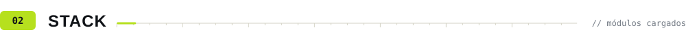</picture>

<picture><source media="(prefers-color-scheme: dark)" srcset="./assets/generated/stack-dark.svg"></picture>

 

<picture><source media="(prefers-color-scheme: dark)" srcset="./assets/generated/divider-proyectos-dark.svg">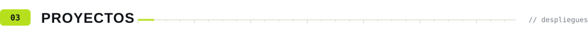</picture>

<a href="https://github.com/omarhernandezrey/FlexiCommerce"><picture><source media="(prefers-color-scheme: dark)" srcset="./assets/generated/project-1-dark.svg"></picture></a> <a href="https://github.com/omarhernandezrey/Jarvis"><picture><source media="(prefers-color-scheme: dark)" srcset="./assets/generated/project-2-dark.svg"></picture></a>

<a href="https://github.com/omarhernandezrey/diccionario-dev"><picture><source media="(prefers-color-scheme: dark)" srcset="./assets/generated/project-3-dark.svg"></picture></a> <a href="https://github.com/omarhernandezrey/linktic-backend"><picture><source media="(prefers-color-scheme: dark)" srcset="./assets/generated/project-4-dark.svg"></picture></a>

 

<picture><source media="(prefers-color-scheme: dark)" srcset="./assets/generated/divider-trayectoria-dark.svg">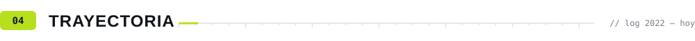</picture>

<picture><source media="(prefers-color-scheme: dark)" srcset="./assets/generated/timeline-dark.svg"></picture>

EN PRODUCCIÓN <a href="https://tienda-lizz-io.vercel.app"><b>Tienda Lizz</b></a> &nbsp;·&nbsp; <a href="https://enfermeria-roxana.vercel.app"><b>Roxana Enfermera</b></a> &nbsp;·&nbsp; <a href="https://diccionario-dev-xi.vercel.app"><b>Diccionario Dev</b></a>

 

<picture><source media="(prefers-color-scheme: dark)" srcset="./assets/generated/divider-educacion-dark.svg">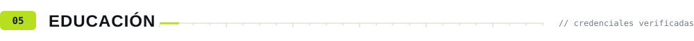</picture>

<picture><source media="(prefers-color-scheme: dark)" srcset="./assets/generated/education-dark.svg"></picture>

<a href="./assets/certificates/sena-tecnologo-adsi.jpg"><picture><source media="(prefers-color-scheme: dark)" srcset="./assets/generated/cert-1-dark.svg"></picture></a> <a href="./assets/certificates/talento-tech-full-stack.jpg"><picture><source media="(prefers-color-scheme: dark)" srcset="./assets/generated/cert-2-dark.svg"></picture></a> <a href="./assets/certificates/itcertificate-full-stack.jpg"><picture><source media="(prefers-color-scheme: dark)" srcset="./assets/generated/cert-3-dark.svg"></picture></a>

<a href="./assets/certificates/itcertificate-back-end.jpg"><picture><source media="(prefers-color-scheme: dark)" srcset="./assets/generated/cert-4-dark.svg"></picture></a> <a href="./assets/certificates/ibm-git-github.jpg"><picture><source media="(prefers-color-scheme: dark)" srcset="./assets/generated/cert-5-dark.svg"></picture></a> <a href="./assets/certificates/platzi-react.jpg"><picture><source media="(prefers-color-scheme: dark)" srcset="./assets/generated/cert-6-dark.svg"></picture></a>

Haz clic en cualquier certificado para verlo completo.

 

<picture><source media="(prefers-color-scheme: dark)" srcset="./assets/generated/divider-actividad-dark.svg">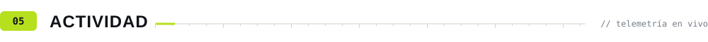</picture>

<picture><source media="(prefers-color-scheme: dark)" srcset="./assets/generated/telemetry-dark.svg"></picture>

 

<a href="mailto:omarhernandezrey@gmail.com"><picture><source media="(prefers-color-scheme: dark)" srcset="./assets/generated/footer-dark.svg"></picture></a>
